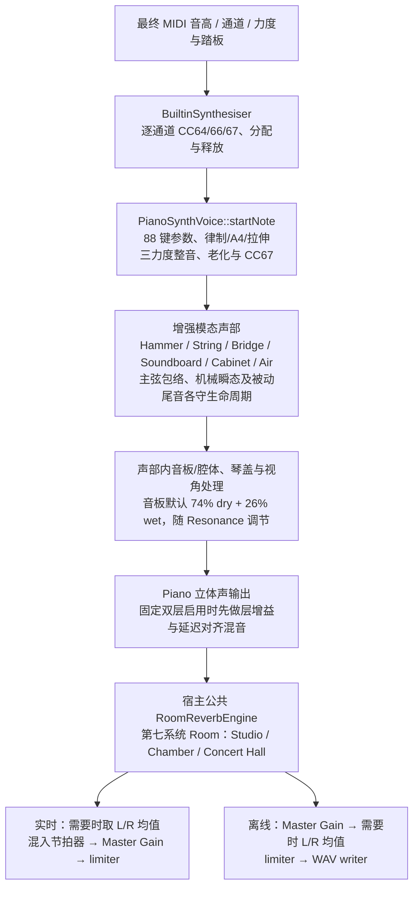

# 内置物理建模钢琴音源功能说明与技术参考

> 用途：说明 devpiano 自主研发、纯 C++ 物理建模钢琴合成器（`PianoSynthVoice`）的完整声学物理系统、算法机理、参数控制、实时性能、分层并发契约与测试验收清单。
> 行为契约：默认内置发声来源；产品自有发声路径必须保持零堆分配、零锁、全回调零库函数三角。测试桩的已测场景只提供有限证据，不等于无条件证明或第三方路径认证。8 复音单核 CPU ≤0.7% 的长期 SLA 目标与具体测量结果分开登记，不将 Debug 结果称为目标认证。项目状态以 [roadmap](../../roadmap/roadmap.md) 为准。
> 更新时机：声学物理模型、DSP 拓扑结构、88 键参数表、音色控制链路或硬实时契约发生变化时。

---

## 1. 概述与设计定位

`PianoSynthVoice` 是 devpiano 核心发声链路中的默认内置音色。它是一个**自主研发、纯 C++ 驱动、零外部音频采样依赖**的现代全物理建模钢琴合成器。

```text
               ┌────────────────────────────────────────────────────────┐
               │        devpiano Built-in Physical Modeling Piano       │
               │                   (PianoSynthVoice)                    │
               └───────────────────────────┬────────────────────────────┘
                                           │
         ┌─────────────────────────────────┼────────────────────────────────┐
         ▼                                 ▼                                ▼
┌──────────────────┐             ┌──────────────────┐             ┌──────────────────┐
│   零外部资源依赖 │             │ 7 大完整声学系统 │             │ 极低实时 CPU 开销│
│ 紧凑物理参数建模│             │ 覆盖击弦/弦体/共鸣│             │ Magic Circle 递归│
│ 零 SFZ/PCM 采样  │             │ 机械/空间/微调律制│             │ 逐采样零 std::sin│
└──────────────────┘             └──────────────────┘             └──────────────────┘
```

### 设计目标与工程特征

1. **零外部采样依赖**：代码由现代 C++ 声学模块（`PianoSynthVoice.h`、`Piano88KeyTable.h`、`RoomReverbEngine.h`、`PerspectiveProcessor.h`、`TemperamentEngine.h`）构成，编译后二进制体积极小，彻底摆脱对数百 MB 至数十 GB 外部采样音色库的依赖；
2. **7 大声学系统建模**：覆盖琴槌（Hammer）、琴弦（String）、琴桥（Bridge）、音板（Soundboard）、琴体（Cabinet）、空气（Air）与空间（Room），沿用增强模态近似，不声称与商业物理建模产品的微观实现一致；
3. **硬实时保证与性能边界**：Magic Circle 递归振荡器和预计算/有界数学保留逐采样与控制级零库函数三角、产品自有路径零堆分配和零锁。8 复音单核 CPU 占用 $\le 0.7\%$ 的长期 SLA 目标保留，具体配置必须单独验证，不能由旧测量或 Debug 单次耗时外推；
4. **内置音色切换**：Piano 与 `SineSynthVoice` 共用音频线程拥有的 `BuiltinSynthesiser` 无锁调度，支持切换与基准比对；不依赖 JUCE 基类的默认锁式发声调度。

**音色重建所有权**：`MainComponent::setBuiltinSynthTone()` 复用停设备守卫，先关闭 Editor 并等待已有音频 callback 退出，再调用 `AudioEngine::rebuildSynth()` 和提交活动 voice/roomReverb 参数；启动命令与再次启动的 `--piano` / `--sine` 走同一路径。普通参数 setter 仍只发布原子待提交值，由音频所有者或明确的停机 prepare 窗口消费，不把逐次 Synthesiser 内部锁视为整个重建的并发保护。

---

## 2. 7 大声学物理系统与 DSP 渲染架构



---

### 2.1 琴槌打击系统（Hammer System）

真实钢琴的琴槌是由多层羊毛毡包裹木芯构成的非线性弹性体，击打琴弦时表现出强烈的力度依赖性与瞬态特征：

1. **三层毛毡动力学压实模型（Chaigne & Askenfelt 1994）**：
   - 琴槌名义硬度随击键力度、硬度设置、三力度锚点与毛毡老化增长：
     $$h_{\text{hammer}} = \operatorname{clamp}\left(0.15 + 0.85 v^{1.5} \cdot (0.5 + 0.5 \cdot \text{hardness}) + \Delta h_{\text{anchor}}(v) + \Delta h_{\text{felt}},\ 0.05,\ 1.0\right)$$
   - CC67 弱音/移位踏板再派生弦接触硬度：
     $$h_{\text{contact}} = \operatorname{clamp}\left(h_{\text{hammer}} \cdot (1.0 - 0.25 \mu_{\text{una}}),\ 0.05,\ 1.0\right)$$
   - 琴槌与琴弦的有效接触时间 $T_c$ 使用接触硬度：
     $$T_c(v) = T_{c,\text{base}} \cdot (2.5 - 1.9 h_{\text{contact}}) \cdot (1.0 + 0.20 \mu_{\text{una}})$$
   - 主硬度旋钮只通过同一 $h_{\text{hammer}}$ 生效；分音频谱使用 $h_{\text{contact}}$，瞬态核使用 $h_{\text{hammer}}$。不再另乘一条宏硬度分音倾斜，避免同一硬化效果重复计入。
   - 琴槌毛毡低通的滚降指数可随三力度锚点做校准残差：
     $$p_{\text{felt}} = \operatorname{clamp}\left(2.0 - 0.80 h_{\text{contact}} + \Delta p_{\text{anchor}}(v),\ 0.80,\ 6.0\right)$$
     $\Delta p_{\text{anchor}}$ 与硬度、响度一样按 41/70/98 锚点插值；它只改变同一毛毡低通的斜率，不新增独立高频增益或第二个 EQ。
   - 动态截止频率与速度相关滚降指数（弱奏 $pp$ 时高频快速衰减呈温润暗色，强奏 $ff$ 时高频充分释放清脆明亮）；三力度锚点以相对增量进入 $h_{\text{hammer}}$，默认零偏移不改变现有力度响应。
   - 作用顺序固定为：力度基线 + 三锚点 + 毛毡老化 -> $h_{\text{hammer}}$；CC67 -> $h_{\text{contact}}$；Brightness 作为全局分音倾斜与阻尼控制；击弦点梳状陷波独立于硬度/亮度。响度由锚点 dB 增量和力度增益单独控制，不重复进入硬度或频谱倾斜。

2. **击弦点几何梳状陷波（Striking Position Comb Filter）**：
   - 琴槌击弦位置 $x_0 / L$ 严格按 88 键物理位置查表（低音区 $\approx 1/8$，高音区过渡至 $\approx 1/14$）；
   - 对各次分音引入空间几何梳状增益：
     $$S(m) = 0.06 + 0.94 \cdot \left| \sin\left( \frac{m \pi x_0}{L} \right) \right|$$
   - 物理抑制敲击点对应的第 7～9 阶非协和杂音。

3. **3ms 起音瞬态裂音与碰撞核（Attack Transient Crack & Strike Click）**：
   - 在击键最初 $3\text{ ms}$ 内注入与力度平方 $v^2$ 强耦合的高频瞬态裂音（HF Attack Crack）以及 $1.1\sim 4.5\text{ kHz}$ 毛毡撞击木核；
   - 工程门控保持 $\text{Attack} \le 0.2\text{ ms}$；WAV 的 RMS 上升时间、琴槌接触时间与软件延迟分别量测，不用输出包络反推门控或接触求解器。

4. **琴槌接触微阻尼与脱离释放（Contact-Release Dynamics）**：
   - 在有效 $T_c$ 窗口内，主弦和采用逐采样从 0.55 到 1 的有界接触释放增益，随后保持自由振动增益 1。该状态在生产发声路径每个主弦样本推进一次；Strike Click、制音器和踏板机械瞬态不乘此增益。它是工程接触包络，不是已验证的粘滞接触力或完整非线性求解器。

5. **琴槌毛毡微老化物理动力学（Felt Ageing Dynamics）**：
   - 引入连续老化参数 $A_{\text{felt}} \in [0, 1]$（`feltAgeingAmount`，默认 0.0 保留纯净基准）；
   - 以逐键确定性扰动调整有效硬度（最多 $\pm0.06A_{\text{felt}}$）、亮度（最多 $\pm0.04A_{\text{felt}}$）、刚度（最多 $\pm4.5\%A_{\text{felt}}$）及音高（最多 $\pm1.2A_{\text{felt}}$ cents）；接触时间经同一有效硬度模型计算。该工程扰动不认证真实毛毡老化；校准基线关闭老化。
   - 试听提示：固定同音高、同力度，A/B 对比 `feltAgeingAmount=0` 与 `1`；变化是逐键、确定性的微小硬化/亮度/音高离散，不是明显失谐、合唱或颤音。C4 实测老化 0→1 的 HF 约 `0.9–1.3 dB`、RMS 约 `0.07 dB`，需要仔细听起音与音色细微差异。

---

### 2.2 琴弦与动力学系统（String & Dynamics System）

1. **JOS PASP 刚性琴弦失谐（Stiffness Inharmonicity）**：
   - 引擎以律制/A4 频率 $f_T(n)$ 对应实际第一分音基准，刚度分音比归一化：
     $$f_m = m f_T(n)2^{s_n/1200}\sqrt{\frac{1+B_n m^2}{1+B_n}}$$
   - $s_{69}=0$；关闭拉伸时 $s_n=0$。同音弦微失谐与刻意老化抖动在基准之外叠加，不要求所有同音弦都无拍频。主弦只保留最高实际失谐弦频率低于 $0.477485f_s$ 的连续分音前缀，与 $\lvert\epsilon\rvert\le1.995$ 一致，不将保留弦钳成另一音高。无可保留第一分音时仅保留安全上限处的降级第一分音；8 kHz 的这种降级不承诺原音准。超 Nyquist 的 Duplex 模态仍旁路。
   - `PianoTuning.h` 预计算默认逐键拉伸比例：A4 以下以 4:2、以上以 2:1 八度分音匹配递推，A3–A5 锚点间平滑插值；中央插值区不保证每个分音对都严格相等。律制独立，Sine 与 VST3 MIDI 不套用钢琴拉伸，已起音基频不因切换调律重新定位。
   - $B$ 来自受控软件参考锚点、段间 log 插值与高音文献外推，G2/G#2 处不再叠加旧阶跃；不认证 Steinway 或其他实琴的逐键测量。理论参考 [JOS stiff piano strings](https://ccrma.stanford.edu/~jos/pasp/Stiff_Piano_Strings.html)，参数来源见下方 88 键参数表；Railsback 观察曲线不是由 $B$ 唯一确定的通用算法。

2. **Magic Circle 二阶递归正弦振荡器（Coupled Form）**：
   - 彻底消灭发声振荡核心逐采样循环的 `std::sin` 调用，采用工控与专业 DSP 领域的耦合形式正弦振荡器：
     $$u[n] = u[n-1] - \epsilon \cdot v[n-1]$$
     $$v[n] = v[n-1] + \epsilon \cdot u[n]$$
   - $\epsilon = 2\sin(\pi f_m/f_s)$ 是模型公式；起音与机械闭包使用预计算表和有界多项式。固定 $\epsilon$ 的单位输出振幅初始化为 $v_0=\sin\phi$、$u_0=\sqrt{1-\epsilon^2/4}\cos\phi+\epsilon\sin\phi/2$，避免普通圆坐标在近上限频率引入椭圆增益；平方根仅在 NoteOn 计算，逐采样仍为递推。短时 Pitch Glide 的变系数状态与 guard 单独保留，不据此宣称机械能量守恒。

3. **固定微初相色散矩阵（Micro-Phase Dispersion Table）**：
   - 避免 $t=0$ 所有分音同相聚焦；
   - 内嵌固定 $3 \times 64$ 初始相位矩阵（`kOptPhaseTable`）；不包含 STFT 最优相位训练输入或认证声明，不将其包装成实测最优相位。

4. **同音三弦 Mid-Side 差分立体声展开与非对称拍频（Weinreich 1977 JASA）**：
   - 中高音区每键 3 根琴弦分别采用微失谐振荡器（$s_1, s_2, s_3$），并以 Mid-Side 差分矩阵展开至立体声场：
     $$s_{\text{sum}} = \frac{1}{3}(s_1 + s_2 + s_3), \quad \Delta s = \frac{1}{3}(s_3 - s_1)$$
     $$\text{Left} = s_{\text{sum}} - g_{\text{spread}}\Delta s,\quad \text{Right} = s_{\text{sum}} + g_{\text{spread}}\Delta s$$
   - 原始弦信号等权下混时差分抵消；完整 mono 输出仍须消费后续音板、Duplex、机械瞬态、琴盖和视角处理。这是独立失谐振荡器与工程空间映射，不是已验证的 Weinreich 动态能量交换或真实琴桥辐射。

5. **低音钢弦纵向波先驱脉冲（Longitudinal Precursor Ping，Bank 2005/2010）**：
   - 钢弦内部纵向声速 $v_L = \sqrt{E/\rho} \approx 5100\text{ m/s}$，远快于横波传播速度；
   - 为低音琴键（MIDI 21～55）注入极速衰减（$15\text{ ms}$）的金属张力先导冲击，赋予低音真实的钢铁撞击张力；
   - MIDI 48～55 使用 smoothstep 连续收尾，MIDI 56 起为零。纵波是独立生成的附加激励，不参与同音弦相位补偿，也不继承其增益；该边界是工程整音值，不是实测纵向模态截止。

6. **泛音时间滞后膨胀与绽放（Harmonic Blooming）**：
   - 强奏时弦体非线性张力将能量持续泵浦至高阶分音；
   - 为 $n \ge 3$ 阶高次分音引入单极点上升包络（$\tau_{\text{bloom}} \approx 8\sim 24\text{ ms}$），使高次泛音在击弦后数十毫秒内蓬勃绽放。

7. **强击非线性音高微漂移与软饱和（Pitch Glide & Soft Saturation）**：
   - $fff$ 强击瞬间琴弦张力增加导致音高产生 $2\sim 5$ 音分的瞬态上浮（$20\sim 40\text{ ms}$ 内指数回落）；结合音板三次谐波软饱和，重现大动态下的金属张力张力感。

8. **泛音刚度不谐和度抖动（Inharmonicity Jitter）**：
   - 采用确定性逐键整数哈希，为 88 键分别注入 $\pm 4.5\%$ 的微观不谐和度刚度扰动 $\Delta B$ 与 $\pm 0.3\sim 1.2\text{ cents}$ 基频分散微调；
   - 真实再现手工缠弦厚度微偏差与挂弦张力离散度，彻底打破纯算法生成的过分对称与人工冰冷感。

---

### 2.3 琴桥与共鸣系统（Bridge, Soundboard & Resonance System）

1. **长短琴桥交界（Bridge Break）**：
   - `isBassBridge` 在 MIDI 43/44（G2/G#2）处划分低音长琴桥与主琴桥（描述性分区语义）；弦数在 MIDI 48（C3）转入三弦，弦长/阻尼为连续插值、无阶跃；**刚度 B 的原 +43% 阶跃假设已由官方参考实测否定**（43/45/47/48 平滑递增），生产 B 表冻结于 19 节点（17 个官方参考实测锚点 + 96/108 两文献外推节点；26/52/57 由 interp-training 扩充），停止接收入训锚点。

2. **16 峰正交云杉木物理音板模态组（Bank 2010 / Chabassier 2019）**：
   - 挂载 16 组精确调谐的二阶带通共振滤波器，全频段覆盖云杉木音板核心模态：
     - `48 Hz / 68 Hz`：音板与背架底箱主呼吸模态；
     - `95 Hz / 135 Hz`：低音长琴桥弯曲模态；
     - `185 Hz / 250 Hz`：音板主板面弯曲与对角线模态；
     - `340 Hz / 460 Hz`：肋木与琴桥交叉耦合模态；
     - `620 Hz / 820 Hz / 1080 Hz`：中高频木质辐射模态；
     - `1380 Hz / 1680 Hz / 1850 Hz / 2050 Hz / 2250 Hz`：各向异性高频散射模态。

3. **云杉木 4.2kHz 高频粘滞内耗低通滤波器（Spruce Soundboard Filter）**：
   - 模拟天然云杉木纤维对超高频能量的各向异性粘滞吸收，消除电子合成器常见的铁皮金属盒共鸣毛刺，赋予音色深厚温暖的木质感。

4. **琴桥立体声空间辐射与声像几何投影**：
   - 依据 88 键在长短琴桥上的物理跨度（低音偏左、高音偏右），结合音板散射矩阵计算立体声投影，消除单声道耳膜居中压迫感。

5. **Duplex 非发音弦段**：
   - 每声部固定两个主弦驱动的阻尼旋转模态，代表相对发音弦长的前/后非发音段；逆长度比为 5.0 / 3.02，衰减时间常数 0.09 / 0.16 秒。刚度、实际起音第一分音与老化扰动共同决定段频率；这些是模型参数，不是特定琴型测量。
   - 递推半径小于 1，驱动为主弦 `rawMono`，归一化输入系数为 `1-radius`；无输入不产生能量，不以 CC64 或按键持有作为存在条件。两个模态均值与既有主输出按最多 `0.12 * duplexResonance` 的凸组合混合，只进入一次琴盖/视角/公共 Master。
   - amount 变化使用 5ms 平滑；0 为旁路，超 Nyquist 模态禁用。主音释放后保留原 NoteOn 通道身份直到可辐射尾音结束；CC120/Panic 按原通道清理，结束时清空微小状态，避免无声占用声部。
   - 主弦包络结束或分音静音时，不清空仍在输出 Duplex 的琴盖延迟线与视角滤波状态；共享输出处理器在声部及机械/踏板尾音结束后清理，立即停音与声部重用仍完整重置。回归对照同一事件时序的不同渲染分段，防止尾音因块边界被提前截断。
   - 现有十二音级开放主弦交感池依旧单独存在，调谐消费同一 A4/律制/拉伸基准；它不等同于 Duplex，也不建模 Blüthner 独立 Aliquot 第四弦。

---

### 2.4 空间、机械与环境拟真系统（Cabinet, Air & Mechanical System）

1. **16 通道踏板矩阵与交感共鸣系统（Pedal Matrix & Sympathetic Resonance）**：
   - **16 通道踏板物理隔离**：`BuiltinSynthesiser` 独立维护 16 个 MIDI 通道的踏板物理状态矩阵（CC64 延音 `sustainPedalByChannel`、CC66 保持音 `sostenutoPedalByChannel`、CC67 柔音 `softPedalByChannel`）；
   - **CC66 捕获边界**：仅低→高捕获当时仍按住的声部；重复高值不捕获后起音，被抢占声部的新音不继承旧捕获。CC64/66 释放顺序、同采样排序、逐通道隔离和 Panic 均按声部生命周期处理；电脑键盘入口及原目标释放见 [键盘分册](keyboard-mapping.md)。
   - 踩下 CC64 延音踏板时激活 12 半音全开放交感共鸣弦池，使演奏音符的泛音激发全琴未制音琴弦的共振；
   - **踏板机械扫掠声与共鸣冲击**：踩下踏板时激发成对的机械毛毡抬起刮擦与空气呼啸脉冲（`pedalWhoosh`，带通 $1350\text{ Hz}$，$Q=1.25$；抬起带通 $950\text{ Hz}$）以及全琴瞬态弱冲击激发（`pedalResonanceShock`，双共振冲击峰 $58\text{ Hz}$ 与 $116\text{ Hz}$），由 `pedalNoiseLevel`（默认 0.6）线性缩放；
   - 支持**未踩踏板时的单键开放主弦交感（Unpedaled Resonance）**：由持有音符对应音级的开放主弦产生交感振动；Duplex 非发音段见上节，不混称为同一模型；
   - **CC67 弱音/移位踏板物理拟真（Una Corda / Soft Pedal）**：踩下 CC67 踏板时击弦机向右微移，敲击毛毡侧面相对柔软区域（有效硬度衰减至多 25%，接触时间延长至多 20%），中高音区三弦组产生三弦敲两弦（Trichord to Bichord）声能衰减（至多 30% 衰减），呈现柔和朦胧的暗调色泽；
   - **柔音状态所有权**：实时和内置离线合成共用 `BuiltinSynthesiser`，按 MIDI 通道保管 CC67 连续值（`0.0 ~ 1.0`），在新声部 `startNote()` 前应用；重新分配和偷声部不继承其他通道的柔音。机械聚合声部的宽监听谓词不作为 NoteOn/NoteOff 或柔音的发音通道身份。CC67 Up / CC121 更新当前与后续声部，CC120/123 不冒充踏板释放。

2. **琴盖开合度声学传递函数（Lid Position Acoustics）**：
   - 支持 3 种琴盖物理状态：全开（Full Open）、半开（Half Stick）、闭盖（Closed Lid）。

3. **制音器落木闷击与琴键释放机械瞬态（Damper Release & Key Thump）**：
   - 琴键释放时，制音器机械臂带动羊毛毡压回琴弦：
     - 快离键（$v_{\text{rel}} > 0.6$）：激发显著的木质制音头撞击闷响（Wood Thump）并伴随陡峭的高频能量消散；
     - 慢离键（$v_{\text{rel}} \le 0.6$）：延长羊毛毡与琴弦微弱摩擦接触时间，保留轻柔舒缓的余音渐退；
     - 高音无制音器区（MIDI > 88）：跳过毛毡吸振阻尼，但忠实保留按键弹回木质撞击声；
     - **动态 ADSR 离键阻尼缩放**：根据离键速度动态调节释放时间常数 $\tau_{\text{rel}} = \tau_{\text{base}} \cdot (1.5 - 0.75 v_{\text{rel}})$，且基准配置参数跨生命周期严格保持不被永久覆盖。

4. **立体声空间视角成像（PerspectiveProcessor）**：
   - 提供**演奏者视角（Player）**与**听众视角（Audience）**双重声学渲染：
     - 演奏者视角：88 键琴桥展开，低音居左、高音居右，近场宽广；
     - 听众视角：声像左右镜像翻转，并施加适度的高频空气吸收与中置凝聚感。

5. **轻量数学算法房间混响网络（RoomReverbEngine）**：
   - 内置纯数学算法立体声混响网络，基于 8 组互质延时反馈梳状滤波阵列与 4 级全通扩散矩阵（Schroeder-Moorer 架构演进），零外部采样依赖；
   - 提供 **Studio（录音棚 0.6 s）**、**Chamber（室内乐厅 1.5 s）** 与 **Concert Hall（音乐厅 2.4 s）** 三大经典声学空间预设（C++ 枚举 `ReverbSpace::studio`、`chamber`、`concertHall`；文件持久化标识分别为 `studio`、`chamber`、`concert_hall`，旧别名 `hall` 不再映射，未知标识安全回退至 `chamber`），支持平滑干湿比（`reverbWet`）无级调节；
   - **直通与抗下溢保护**：`RoomReverbEngine::processStereo()` 在目标与平滑后的当前 wet 均 `<= 1e-4` 时旁路混响 DSP，保留边界判断；实时入口启用 `juce::ScopedNoDenormals`，滤波器内部另有衰减归零保护。
6. **动态声场空间漫射（Dynamic Spatial Diffusion）**：
   - 空间声相展开度（Stereo Spread）随时间连续演化：$t=0$ 起振瞬间聚焦于琴桥敲击点（点声源），并在 $25\text{ ms}$ 内经由音板共振与空气反射平滑漫射为整个琴腔的面声源包围场。

---

## 3. 88 键物理参数化表（`Piano88KeyTable.h`）

`PianoSynthVoice` 使用 **88 键连续物理参数模型**。弦长/阻尼以 Bensa 等文献为设计线索，保留固定模型值；刚度 $B$ 使用 **19 个节点**：17 个受控软件参考锚点（MIDI 21/24/26/28/33/36/40/43/45/47/48/52/57/60/69/72/84）与 96/108 两个文献外推节点，节点间 log 插值。21/24/26/28 按 v41 弱力度政策取值，其余锚点取独立通过族中位数；84 以上自 C6 参考锚点按 Young 1952 / Rigaud-David-Daudet 2013 的高音桥斜率外推。软件输出拟合不认证真实弦身份、特定琴型逐键参数或高音全域实测；Task 39-2 的 inconclusive 收尾与表冻结边界见 [任务记录](../../roadmap/current-iteration.md#task-39-2-收尾记录2026-10-19证据不足--不注入-b)，不把生产回归通过当成外部校准成功：

| 参数项 | 符号 | 取值范围 (A0 → C8) | 物理意义与声学作用 |
|---|---|:---:|---|
| **激活分音数** | `partialCount` | 20 → 6 | 随音高上升动态剪枝，平衡高频解析力与计算开销 |
| **琴弦配置** | `stringCount` | 1 弦 (21~35) / 2 弦 (36~47) / 3 弦 (48~108) | 物理单弦、双弦、三弦真实分区 |
| **琴桥归属** | `isBassBridge` | 低音桥 (21~43) / 主琴桥 (44~108) | 记录低音/主琴桥分区语义（Task 39-2 后为描述性字段，不参与 DSP 或 B 计算） |
| **有效弦长** | `stringLength` | 1.92 m → 0.09 m | 决定基频与纵波先导声时差 |
| **刚度失谐系数** | `inharmonicityB`| $4.77 \times 10^{-5} \to 2.92 \times 10^{-2}$ | 控制泛音非谐波性金属质感（**17 个官方参考实测锚点**（21–84）：A1 处 $4.77 \times 10^{-5}$ 为全琴最小值，A0 $1.37 \times 10^{-4}$，D1 $6.87 \times 10^{-5}$，C4 $3.53 \times 10^{-4}$，C6 $3.16 \times 10^{-3}$；24–28 段实测剖面为 V 形（D1 最低）；84 以上按公开文献的高音桥标准斜率外推（ln B $0.0926$/键 = 每八度 3.04 倍；Young 1952 / Rigaud-David-Daudet 2013），96 为 $9.61 \times 10^{-3}$、C8 为 $2.92 \times 10^{-2}$；原 G#2 阶跃假设、4e-2/8.5e-2 保留上界均已由实测/文献否定；19 节点段间对数插值并已冻结） |
| **击弦比** | `strikePosRatio` | $1/8 (0.125) \to 1/16 (0.0625)$ | 决定几何梳状陷波抑制点（低音 0.125，主琴桥折角 0.1333，高音 0.100，极高音 0.0625） |
| **接触时间** | `tcBase` | 3.0 ms → 0.6 ms | 控制琴槌冲击持续时间与动态截止点 |
| **同音微失谐** | `beatingDetuneRatio` | 0.0020 → 0.0（相对频率） | 实际双弦各偏移半个比例，三弦低/中心/高各按完整比例；拍频分音上限由 `beatingPartials = min(partialCount, 6)` 约束；cents 应由频率比取对数，不使用未参与声音的 `detuneCents` 线性近似当物理证明 |
| **基础慢衰减** | `decaySeconds` | 4.8 s → 0.8 s | 决定琴弦慢分量自然延音长度 |
| **快衰减比率** | `fastDecayRatio` | $0.12 \to 0.18$ | 琴弦早期辐射衰减速度与慢衰减之比 |
| **阻尼常数** | `b1` / `b2` | $0.25 \to 9.17\text{ s}^{-1}$ / $7.5\times10^{-5} \to 2.1\times10^{-3}\text{ m}^2\text{s}^{-1}$ | 当前模型使用 $b_1+b_2(m\pi/L)^2$；这里只澄清量纲，不认证材料常数或改变数值 |
| **模态阻尼斜率** | `decayDampingC` | $0.38 \to 0.12$ | 模态阻尼随音高变化斜率 |

> **离散分区与相位收敛**：`stringCount` 与 `partialCount` 仍为离散配置，拍频分音保持 `min(partialCount,6)`，不恢复 MIDI 96 硬切。当前生产路径保留低中音区原有独立初相；在既有 MIDI 80–100 失谐收敛区间内，相差沿最短角差连续归零，避免零失谐处突然换相。振幅采用下述单音总预算，不逐分音加补偿、不增加逐键增益表。历史 U2 的台阶改善保留为局部结构证据，但整体音色由后续恢复候选重新建立；人工验收与默认整音切换记录见[当前迭代](../../roadmap/current-iteration.md#task-39-5--39-3-用户受控试听反馈与音色验收重开记录2026-10-19)。

---

## 4. 参数控制与外部接口规范

### 4.1 核心音色与物理控制参数

| 参数 | 接口方法 / 成员变量 | 默认值 | 物理调节效果 |
|---|---|:---:|---|
| **Brightness（亮度）** | `setPianoParameters` / `pianoBrightness` | 0.5 | 调节激振分音倾斜及整体阻尼缩放，不直接改变有效硬度 |
| **Hammer Hardness（硬度）** | `setPianoParameters` / `pianoHammerHardness` | 0.5 | 只通过同一名义硬度 `h_hammer` 影响接触时间、分音频谱和瞬态核；分音频谱使用 CC67 后的 `h_contact`，不再另设分音硬度倾斜 |
| **Resonance（共鸣）** | `setPianoParameters` / `pianoResonance` | 0.5 | 调节 16 峰音板共振 Wet 比率（18%~34%）与延音衰减时间缩放 |
| **Pedal Noise（机械噪声）** | `setPedalNoiseLevel` / `pedalNoiseLevel` | 0.6 | 调节延音踏板扫掠呼啸与共鸣冲击的机械动作音量（0..1） |
| **Felt Ageing（毛毡老化）** | `setFeltAgeingAmount` / `feltAgeingAmount` | 0.0 | 调节琴槌羊毛纤维磨损压实深度，注入微观穿透力与硬化质感（0..1） |
| **Una Corda（弱音踏板）** | `setSoftPedalDown` / `softPedalDown` | false | 琴槌击弦机侧向位移，毛毡软化与三弦敲两弦声能衰减（MIDI CC 67，电平 0..1） |
| **Stretch Tuning（拉伸调律）** | `setPianoTuning` / `stretchTuningEnabled` | true | 保留 A4 第一分音锚点，按本模型分音对匹配八度，不修改 MIDI 身份 |
| **Duplex Resonance（非发音段共鸣）** | `setPianoTuning` / `duplexResonance` | 0.15 | `[0,1]` 被动段凸组合配比，0 旁路，5ms 平滑 |

**内置三力度整音锚点**：`HammerVoicing` 以相对现有力度基线的增量保存三锚点；Task 39 音色修复后经人工试听确认的出厂默认为中性零偏移：

| 锚点 | `hardnessDelta` | `loudnessDeltaDb` | `rolloffDelta` |
|---|---:|---:|---:|
| Piano (41) | 0.0 | 0.0 | 0.0 |
| Mezzo forte (70) | 0.0 | 0.0 | 0.0 |
| Forte (98) | 0.0 | 0.0 | 0.0 |

锚点结构、连续插值和范围校验保留，不增加第二条 DSP 路径。中性锚点不叠加额外硬度、响度或滚降；力度响应仍由既有的 $v^{1.20}$、接触时间、分音频谱和击弦瞬态决定。零偏移不是全琴物理常数，也不单独认证任意内核版本的听感。历史 U2 校准值已退役且不自动迁移；当前格式缺省用中性出厂值，显式合法非零配置仍由预设/Take 原样恢复和执行。中性默认下 C4 41/55/70/85/98 的相对响度层次已由用户试听确认足够且正确，不按旧内核数值目标重做校准。

**连续音区整音曲线**：`PianoRegisterVoicing.h` 提供固定出厂曲线，在声部输出级对音符本体、音板/共鸣尾音和 Duplex 尾音施加连续 dB 增益；不改变弦长、调律、分音权重、力度响应或 NoteOff 身份，也不作用于踏板机械声。锚点在 MIDI 坐标上按 dB 线性插值，不是 88 键逐键增益表：

| MIDI | 音名 | 相对增益 |
|---:|---|---:|
| 21 | A0 | +6.0 dB |
| 36 | C2 | +5.0 dB |
| 48 | C3 | +2.0 dB |
| 60 | C4 | 0.0 dB |
| 72 | C5 | -1.0 dB |
| 84 | C6 | -2.0 dB |
| 96 | C7 | -3.0 dB |
| 108 | C8 | -4.0 dB |

该曲线是依据当前生产的音区平衡目标设定的工程整音值，不是实琴逐键测量或等响曲线的直接实现。2026-10-20 用户已人工试听确认锚点方向正确；后续默认参数变更仍需重新进行受控试听验收。

交感共鸣池在音符激励入池前应用音区增益，而不是对共鸣池的混合输出整体缩放；CC64 注入的踏板机械共鸣冲击因此不继承当前或历史音高的增益。音符本体、音板与 Duplex 仍保留原有音区整音，发声和空闲路径均不额外缩放机械踏板声。

自动回归覆盖 A0/C8 的立即清音与自然离键：离屏渲染直到声部及 Duplex 尾音结束，再触发相同 CC64 踏板动作；单声道和立体声输出均须与全新空闲声部在浮点容差内逐样本一致。

**声学快照与普通预设配置子集**：
`PerformancePreset`（Schema v2）的 `acoustics` 子集现在包含 `brightness`、`hammerHardness`、`hammerVoicing`、`resonance`、`stretchTuningEnabled`、`duplexResonance`，以及原有琴盖、触键曲线、柔音、律制/A4、视角、混响和机械字段；仍不包含 `builtinTone`、`masterGain`、ADSR 或 VST3 内部状态。`SettingsModel`、`AcousticSnapshot`、Take 内嵌快照与 `WavExportOptions` 保存同一完整三锚点结构，实时、内置 WAV 和固定双层 WAV 的内置 Piano 都消费它；Sine/VST3 不接收该物理参数。可选字段缺失使用当前出厂默认；显式非法的 `hammerVoicing` 拒绝预设/Take，不静默回退。原始锚点不暴露为主界面旋钮，现有三力度整音由当前常量驱动。

`AudioEngine::setHammerVoicing()`、`getHammerVoicing()` 与公开的 `captureAcousticSnapshot()` 由消息线程使用，录制抓取消息线程最近接受的合法整音，不读取音频线程拥有的活动快照。音频线程仅在整音更新待处理时单次尝试读取原子发布；序号为奇数或读取期间改变时保留上一份完整整音，并保留更新位供下一块重试，其他参数仍照常应用，不忙等发布方。

固定双层开启时 Piano 不随 `builtinTone=sine` 改成 Sine；它与当前单 VST3 消费同一最终 MIDI 身份，使用独立工作缓冲和有界采样延迟，层增益在一次公共 Reverb/Master 之前混合。层开关与配比随 Settings、预设和 Take 保存，不把钢琴逐键拉伸变成对插件的全局 Pitch Bend，详见 [双层渲染契约](plugin-offline-rendering.md)。

设置的 `piano-style-combo` 提供 Standard / Bright / Warm / Intimate / Vintage，只批量提交实际声学字段，不覆盖 A4、律制、全局调号、键位、插件、音源类型或 Master。名称根据已保存声学值（含 `hammerVoicing`）重建，手动改动或不同整音配置显示 Custom，不另存易漂移的风格标签。它们是参数化取向，不是 Upright/Fortepiano 物理结构复刻；随演奏方案恢复须保存普通预设，启动仍优先恢复已选预设 UUID。

### 4.2 古典微调律制与基准音高（`TemperamentEngine`）

```cpp
void setTemperament(devpiano::audio::Temperament temperament);
void setReferencePitchA4(double hz);
```

支持 6 大古典律制（`equal` 平均律、`just` 纯律、`pythagorean` 毕达哥拉斯律、`meantone` 1/4 中庸全音律、`werckmeister3` 韦克迈斯特三律、`kirnberger3` 基恩伯格三律）与 A4 $[400.0, 480.0]\text{ Hz}$ 基准音高微调，默认 440.0 Hz。`TemperamentEngine::clampReferencePitch()` 为引擎、设置、预设与内置离线渲染提供统一限幅，两端均可选择；415.0、432.0、440.0、442.0 Hz 保持正常。

### 4.3 空间视角、琴盖与环境混响

以下是 `PianoSynthVoice` 的控制接口；独立 `PerspectiveProcessor::setPerspective()` 另有可选的 `immediateSnap` 参数，不是 voice 的同名方法：

```cpp
void setLidPosition(LidPosition position) noexcept;
void setSoundPerspective(devpiano::audio::SoundPerspective perspective) noexcept;
```

- **琴盖状态（`LidPosition`）**：`fullOpen`（全开）、`halfStick`（半开）、`closed`（闭盖）；
- **声学视角（`SoundPerspective`）**：`player`（演奏者视角）、`audience`（听众视角）；
- **环境混响（`RoomReverbEngine`）**：C++ 枚举为 `devpiano::audio::ReverbSpace::{studio, chamber, concertHall}`，对应持久化标识 `studio`、`chamber`、`concert_hall`；名义空间时间常数分别为 0.6 s、1.5 s、2.4 s。未知标识（含旧 `hall`）回退 `chamber`，`reverbWet` 范围 `[0,1]`，旁路条件见上方混响机制。

**Mono 输出边界**：声部在琴盖/视角处理后采用 $0.5(L+R)$，正常发声与被动尾音同路。`AudioEngine` mono 分支先由 `roomReverb.processStereo()` 处理立体声延迟混合流（`pianoDelayedView` L/R），再以 $0.5(L+R)$ 下混至单声道，之后叠加节拍器、应用 `activeMasterGain` 并执行 `devpiano::exporting::applyMasterSoftLimiter`。内置 WAV（`WavFileExporter`）与插件/固定双层 WAV（`PluginOfflineRenderer`）严格保持相同拓扑：处理后立体声 -> 独立公共 Room -> Master 增益 -> $0.5(L+R)$ 下混 -> MasterSoftLimiter。声部与混响均不绕过空间处理，不丢掉右声道，亦不夸大宣称非线性限幅下的 mono 功率守恒。

### 4.4 Velocity 动态双映射与 ADSR 门控

- **振幅预算**：力度基线为 $v^{1.20}$，名义全计划分音权重仍计入 L1 分母，剪掉的份额不重分配。当前生产路径另以起音后 0.1–0.3 s 的解析同音弦平均功率，计算一个单音级总标量，保留分音间的相对权重，并将同一标量用于击弦瞬态，避免仅放大主弦而淹没起音。`globalSourceGain=0.49` 仍为公共源级因子，不是输出峰值上限；单音标量不是逐键补偿表，也不构成机械能量守恒或真琴等价声明。低率降级第一分音的安全频率规则保持不变。该路径已通过人工音色验收，但不认证任意硬件或任意内核版本的等价性。
- **音色动态**：力度直接耦合琴槌接触时间 $T_c(v)$、高频裂音 $v^2$、泛音绽放速率与非线性微音高漂移；
- **ADSR 门控与基准保持**：支持 `setAdsrParameters` / `getAdsrParameters`；`startNote` 自动重设基准起音与门控，`stopNote` 根据离键速度动态计算释放阻尼，杜绝参数跨音符泄漏。

---

## 5. 性能特征与无锁并发保障

1. **产品自有回调零库函数三角**：主振荡器逐采样采用 Magic Circle 递推；起音、机械瞬态与踏板气流使用有界数学和查表，节拍器系数在 `prepareToPlay` 预计算。观察范围必须覆盖 `AudioEngine` 的 NoteOn、参数、偷声部和 Panic，而非只计稳态循环；正调用自检、冷准备及未运行的硬件/厂商路径分别记录。
2. **硬实时音频安全与分层并发隔离**：
   - **产品自有发声链路（严格零锁零分配）**：
     - 实时音频回调线程（`renderNextBlock`）**零堆内存分配（No `malloc`/`new`）**；
     - **零锁（No Mutex/Lock）**，重写后的 `BuiltinSynthesiser` 移除了原生 JUCE 内部锁，物理键盘输入与控制器经有界 SPSC 队列（`RealtimeQueue`）注入，多线程参数传递采用 `std::atomic` 或原子快照；
     - 此边界指 `AudioEngine` / `BuiltinSynthesiser` 所有者闭包。JUCE `AudioSourcePlayer` 的设备回调外壳含 `readLock`；无设备主线程 callback 模拟不认证整条系统回调零锁或实际设备 deadline。
     - 消息线程通过 `dispatchPendingDisplayEvents()` 统一刷新键盘高亮并驱动 UI，音频线程不调用 UI/Timer 接口；消息线程持有状态锁时不阻塞音频回调；
     - **几何故障安全防御**：超协商通道数或块长的音频输入在块首直接静音并累计原子故障计数（`pluginBufferResizeCount`），回调内不执行堆重分配；
   - **第三方 VST3 宿主框架层约束（分层验收）**：
     - 当切换至第三方 VST3 插件时，JUCE 原生适配器存在框架层固有开销（`juce_VST3PluginFormatImpl.h` 的 `SpinLock processMutex` 与 `juce_VST3Common.h` 的 `CriticalSection` 转换）；
     - 单块存在 **2048 条 MIDI 消息上限**（`enum { maxNumEvents = 2048 }`），超额事件被框架截断；第三方插件内部行为超出宿主控制。产品自有发声的零锁零分配不外推至第三方插件；
3. **单核 CPU 性能 SLA 与实测边界**：44.1/48 kHz、8 复音的长期目标仍为 **$\le 0.7\%$**，不因单次测量改写目标。该目标不是物理常数，也不由零锁/零分配自动推出；Debug 未优化配置的 callback/音频时长比不是已认证的单核 CPU 占用。
   - Phase 37 的同配置 Duplex 开关增量与 callback 观察见 [直接实施证据归档](../../archive/phase37-38-piano-calibration-and-keyboard-performance.md#phase-37-直接实施证据与验证边界)，没有 Release 构建或 ≤0.7% 认证，不向其他硬件或厂商外推。参数/流程和软件门禁证据随阶段归档保存，后续任务见 [当前迭代](../../roadmap/current-iteration.md)，不能以历史测量认证新增 DSP 成本。
   - Task 39-5 在 Windows Debug 用带已知正调用自检的 IAT 观察器覆盖起音、参数/快照、密集输入、多复音、偷声部、Panic 后重用、44.1/48/96 kHz 重新准备、Take 预设边界与密集长事件回放：产品自有回调闭包内分配、临界区与库函数三角在测试用例场景下均为 0；8 复音起音校准与零偏移的两次 Debug 样本差异方向相反，单次计时方差大于锚点采样成本，表明在当前测量分辨率内未引入明显增量，但不宣称绝对“零成本”或无条件全回调保证。该记录是 Debug 测试桩环境下的单次场景观察，严禁外推为 Release CPU SLA 或物理设备真实 deadline 认证。

---

## 6. 专项确定性测试套件与声学验证

状态列记录物理声学与确定性单元测试基线（整体音色经用户人工验收）；历史验证不外推未测硬件、声卡热插拔或第三方商业 VST3 插件：

| 测试套件 / 物理用例 | 验证物理机理与断言指标 | 状态 |
|---|---|:---:|
| **PianoSynthVoiceTest** | 实际泛音/音色/双阶段衰减、接触释放音频反例、生成分量振幅与同音频率中心、三力度锚点插值/非法配置/单一硬度路径及滚降差异、完整 mono 下混及既有生命周期；不固定参数锚点声明值 | [x] 结构与测试通过（整体音色已由用户人工验收） |
| **PianoTuningAndDuplexTest** | 实际 A4 中心峰、保留/剪枝边界的生产频谱、Duplex 尾音与分段不变性、原通道所有权、mono 尾音及低率越界旁路；默认整音下 C4 上方分音平衡与 95/96 三力度连续性 | [x] 已通过 |
| **PianoSnapshotWavParityTest** | 非零混响、同采样快照/NoteOn、原身份释放及 mono 琴盖/视角/Room 的实时/内置 WAV 对照；误差限于 16-bit 量化 | [x] 已通过 |
| **DamperReleaseTest** | 快离键木质落弦闷击、慢离键羊毛毡摩擦延展、高音无制音区物理旁路、动态ADSR释放速度缩放、ADSR基准跨音符无泄漏 | [x] 已通过 |
| **PedalAcousticsTest** | CC64 共鸣/机械动作；CC66 捕获边沿、重复高值、声部抢占、CC64/66 释放顺序与同采样逐通道隔离；跨区域 Sync Pedal 原目标释放 | [x] 已通过 |
| **FeltAgeingTest** | 逐键扰动确定性与范围、老化前后的实际音频差异、引擎老化参数限幅；不以 getter 或测试侧公式重算证明音高行为 | [x] 已通过 |
| **PerspectiveProcessorTest** | 演奏者/听众立体声像反转镜像、距离高频滚降、声像能量分布与无下溢数值收敛 | [x] 已通过 |
| **RoomReverbEngineTest** | Studio/Chamber/Concert Hall（ReverbSpace::concertHall / 标识 concert_hall，回退未知字符串）三大空间衰减时间常数、干湿比线性缩放与旁路、长时静音衰减无下溢 denormal、跨采样率不变性；getter 与声明断言不作为逐采样 DSP/逐 bit 保证 | [x] 已通过 |
| **SpatialAcousticsTest** | 空间声学设置与当前预设字段磁盘往返、损坏/越界输入限幅；声场与混响 DSP 行为由对应处理器套件验证；不以 getter 复制代替 DSP 保证 | [x] 已通过 |
| **PianoSynthVoiceTemperamentTest** | 持续发声期间改律制/A4 后真实音频有限与稳定；A4 声音基准由实际谱峰回归验证，不复制 getter 公式 | [x] 已通过 |
| **MechanicalAcousticsTest** | 机械噪声与毛毡老化设置存取、当前预设声学字段往返、极端参数下实际音频有限性、幅度与起音连续性；不以声明回声替代物理安全性 | [x] 已通过 |
| **UnaCordaAcousticsTest** | CC 67 弱音/移位踏板物理声学响应、毛毡侧移软化、三弦敲两弦衰减、全链路控制器响应与回放动态踏板稳定性 | [x] 已通过 |

### 6.1 验收证据依据与未验证范围说明

1. **声学与实时实施依据**：全套确定性声学套件与 Phase C/D/E 真实消费验证通过（见 [Phase E 实施记录](../../archive/audit-004-code-quality-fix-phases.md#phase-e-实施记录与直接验证2026-10-04) EVID-040/041/042/043），涵盖全回调 0 三角函数库调用、密集长事件回放零堆增长、两音色银行常驻无内部锁切换与 SPSC 视觉解耦；测试守卫聚焦行为与数值边界，getter 与字段声明复制不作为 DSP/逐 bit 保证；
2. **严禁外推的未验证范围**：
   - **实机物理声卡热插拔**：未在物理 ASIO/CoreAudio 声卡拔出、驱动重启或硬件抖动下执行破坏性测试；
   - **第三方商业 VST3 插件**：宿主托管第三方插件时的性能与稳定性受插件自身实现约束，不在此内置物理音源 SLA 保证范围内。
